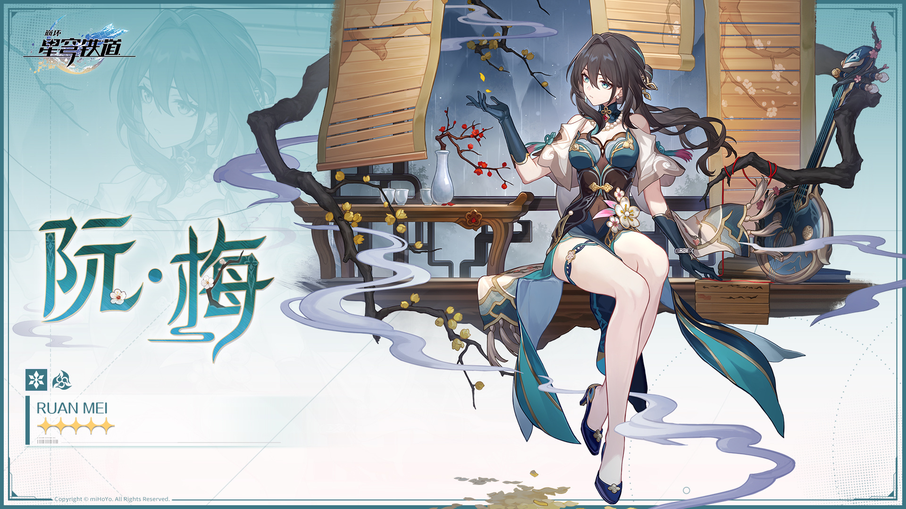

CODE · LINUX · FOOTBALL · GAMES
<h1>52岁建材叶总</h1>

<a href="https://github.com/yks0630">@yks0630</a> &nbsp; / &nbsp; 软件工程 · 大二在读

读软件工程，折腾 Linux，也聊足球和游戏。

<a href="https://github.com/yks0630?tab=repositories">我的仓库 ↗</a> &nbsp; · &nbsp; <a href="https://github.com/yks0630?tab=overview">最近动态 ↗</a>

 

<h2>✦ 先认识一下叶总</h2>

你好，我是 <b>52岁建材叶总</b>，你可以直接叫我<b>叶总</b>。名字听起来像在谈建材生意，实际主业是读软件工程——目前大二，大学副本还在继续。

这里是我的 GitHub，也是我折腾项目的存档点。我参与了 <a href="https://github.com/LaT-SKY/Oddity">Oddity</a> 和 <a href="https://github.com/MipLinux/MipLinux">MipLinux</a> 的构建，接触过 Linux 游戏启动器、发行版构建和安装器相关的工作。项目里有功能、有依赖，也有各种“为什么在这里出问题”的现场。

软件工程还在读，坑也还在踩。写代码、查日志、定位问题、验证改动，这些都是我在项目里练基本功的方式。这里会留下做过的改动和探索过程，方便以后回头看看，也让路过的人知道我最近在忙什么。

 

<h2>✦ 最近在折腾什么</h2>

<h3><a href="https://github.com/LaT-SKY/Oddity">Oddity</a> · 让游戏在 Linux 上跑起来</h3>

Oddity 是《异环》的 Linux 启动器，负责资源下载、校验、更新，并通过 Proton 管理游戏运行环境。这个项目把我喜欢的游戏和 Linux 放到了一起。

我参与过打包依赖相关的修复：补齐 GStreamer 视频插件依赖，处理缺少插件时首页视频引发的窗口冻结问题，同时更新安装、排障文档和检查脚本。一个依赖声明看起来很小，查清楚它为什么会让窗口卡住，就是一次完整的排障练习。

<a href="https://github.com/LaT-SKY/Oddity/pull/83">相关改动：补齐 GStreamer 视频插件依赖 ↗</a> &nbsp; · &nbsp; <a href="https://github.com/yks0630/Oddity">我的 Fork ↗</a>

<h3><a href="https://github.com/MipLinux/MipLinux">MipLinux</a> · 折腾一套发行版</h3>

我是 MipLinux 组织成员，也参与了项目构建。MipLinux 是基于 Arch Linux 的滚动发行版，围绕中文开箱即用、NVIDIA 驱动和安装体验做整合。

我参与过 Live 环境网络变化后的自动测速换源，也做过安装器后端输入校验、异常处理和回归测试相关的修复。除了代码，还会涉及构建、安装验证和配套文档：一次改动最终要在系统里跑起来，才算走完这一圈。

<ul>
  <li><a href="https://github.com/MipLinux/MipLinux/pull/91">Live 环境网络变更后的自动测速换源</a></li>
  <li><a href="https://github.com/MipLinux/MipLinux/pull/160">安装器后端输入与异常处理修复</a></li>
  <li><a href="https://github.com/MipLinux/MipLinux/pull/181">修复色板生成器与生成文件的不同步</a></li>
</ul>

 

<h2>✦ 电脑之外</h2>

<b>足球</b>也是我的爱好。写代码之外，聊聊足球、换换脑子，是另一种快乐。叶总的业务范围，目前可以概括为：软件工程在读、Linux 折腾中，以及足球话题随时可以开场。

我也喜欢游戏和动漫。主页上抱着狮子玩偶的小家伙，就是我选的 Saber；《崩坏：星穹铁道》里的阮梅也是我喜欢的角色。代码之外，总要给自己喜欢的东西留点位置。

 

<h2>✦ 喜欢的角色</h2>

<b>阮梅</b>

  

角色图片来源及说明见 <a href="ASSETS.md">ASSETS.md</a>。

 

<h2>✦ 随便聊聊</h2>

如果你也在折腾 Linux、参与开源，或者只是想聊聊游戏和足球，欢迎认识一下。项目相关的问题和讨论，可以在对应仓库碰面。

感谢来访。代码慢慢写，球也慢慢聊。——叶总 ✦

